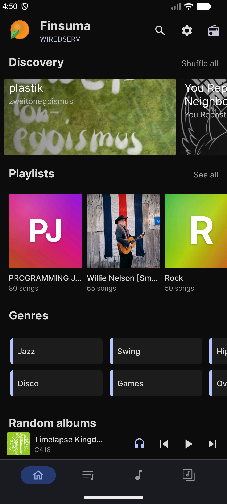
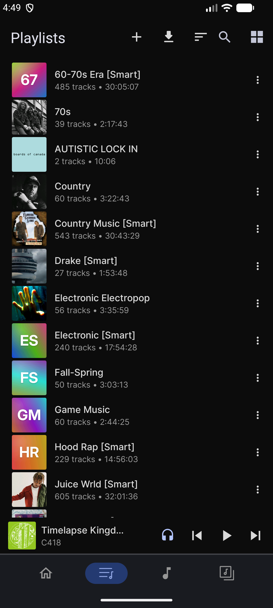
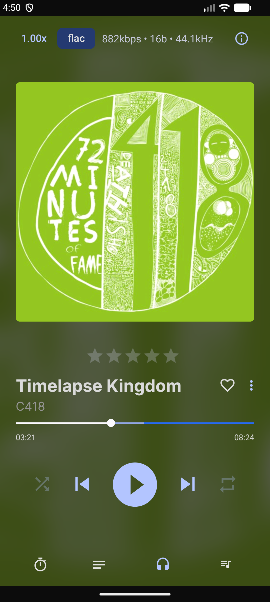
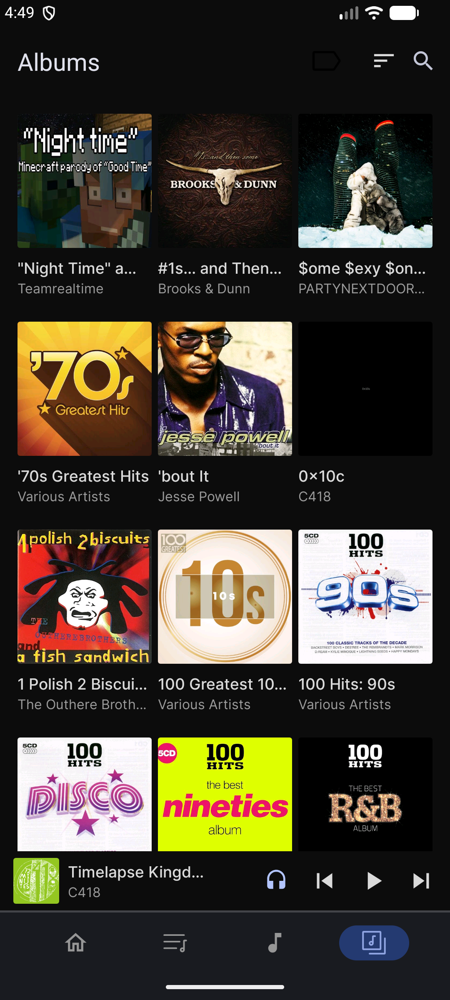

  

  <a href="https://github.com/CameronStorer/finsuma/releases/latest"><b>Download</b></a> ·
  <a href="server/README.md">Finsuma server</a> ·
  <a href="docs/finsuma/backlog.md">Roadmap</a>

## Why Finsuma

I loved [Feishin](https://github.com/jeffvli/feishin), especially its song queuing and Auto DJ,
but I listen through my playlists and wanted the same experience on my phone. Finsuma is a
playlist-first take on Feishin, plus an Android app built to match it, so desktop and phone work
the same way.

  
  
  
  

## Features

- **Playlists first:** playlists lead everywhere, with ratings, pins, favorites and generated covers.
- **Auto DJ** on desktop and Android: keeps the queue going with similar songs, or whole albums.
- **The same queue everywhere:** play next, shuffle and add-to-queue behave the same on both.
- **Car and headphones (Android):** press play with the app closed, or start playing when Bluetooth connects.
- **YouTube and SoundCloud downloads** into your library, with the optional Finsuma server.
- Everything else from Feishin and Tempus: lyrics, scrobbling, smart playlists, Android Auto, offline downloads, themes.

## Get it

Grab Windows, Linux or Android builds from the
[latest release](https://github.com/CameronStorer/finsuma/releases/latest), then sign in to your
Navidrome (or other Subsonic) server.

**Optional:** run the [Finsuma server](server/README.md) next to Navidrome (`docker compose up -d`)
for downloads and synced playlist ratings and pins. Finsuma finds it at `<your server>/finsuma` or
on port 3200 and signs in with your Navidrome login.

## Build from source

| Part | Folder | Command |
| --- | --- | --- |
| Desktop (Electron, fork of Feishin) | `/` | `pnpm install && pnpm run dev` |
| Android (fork of [Tempus](https://github.com/eddyizm/tempus)) | `mobile/` | `./gradlew assembleDegoogledDebug` |
| Server (Python) | `server/` | see [server/README.md](server/README.md) |

Release builds and store notes: [docs/finsuma/releasing.md](docs/finsuma/releasing.md).

## Credits

Built on [Feishin](https://github.com/jeffvli/feishin) by jeffvli and
[Tempus](https://github.com/eddyizm/tempus) by eddyizm (originally
[Tempo](https://github.com/CappielloAntonio/tempo)), with their contributors.
Downloads use [yt-dlp](https://github.com/yt-dlp/yt-dlp) and [FFmpeg](https://ffmpeg.org/).

## License

[GPL-3.0](LICENSE), the same as Feishin and Tempus.
